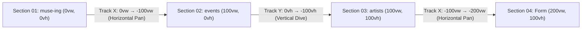

# Muse-ing Landing Page Design Specification (`design.md`)

> **Status:** Production-Ready & Verified  
> **Framework:** Next.js 15 (App Router), React 19, Tailwind CSS v4, Framer Motion  
> **Reference Inspiration:** [Pinterest Pin #1109504058196872790](https://in.pinterest.com/pin/1109504058196872790/) (Editorial Horizontal/Vertical Scroll Interactive Portfolio by `uiuxzaid`)

---

## 1. Executive Summary & Design Vision

The Muse-ing landing page is an **editorial multi-axis kinetic showcase** that connects independent live performing artists with audiences and venue hosts. It bridges high-fashion print editorial minimalism (analog paper textures, generous whitespace, stark typography, museum picture frames) with fluid 60fps kinetic camera choreography.

Unlike traditional static web pages, the viewport acts as a **continuous two-dimensional camera canvas (`300vw` wide by `200vh` tall)** that guides the visitor through an intentional narrative arc:
1. **Section 01 — Brand Introduction (`muse-ing`):** Kinetic horizontal opening with fanned artist cards that disperse on scroll.
2. **Section 02 — Live Gigs Across Venues (`events`):** Horizontal continuation into an organic constellation of venue cards over a massive red backdrop word.
3. **Section 03 — Curated Performing Talent (`artists`):** A theatrical **vertical camera dive downward** revealing the artist roster with vertical 3D counter-parallax.
4. **Section 04 — Booking & Venue Hosting Form:** Horizontal pan into a centered crimson red reservation and host inquiry card.

---

## 2. Design Tokens & Visual Hierarchy

### 2.1 Color Palette

| Token Name | Hex Code | Tailwind / CSS Class | Purpose & Role |
| :--- | :--- | :--- | :--- |
| **Canvas Background** | `#F4EFE6` | `bg-[#F4EFE6]` | Warm tactile cream/ivory paper canvas; warm editorial aesthetic |
| **Vignette Radial** | Radial Overlay | Custom inline CSS | Subtle center illumination (`rgba(255,252,245,0.6)`) to warm edge shade (`rgba(219,208,190,0.65)`) |
| **Editorial Crimson** | `#D92323` | `text-[#D92323]`, `bg-[#D92323]` | Primary accent; giant serif background words (`muse-ing`, `events`, `artists`), active nav dots, section 4 form |
| **Deep Charcoal Ink** | `#181615` | `text-[#181615]`, `bg-[#181615]` | High-contrast typography, primary buttons, borders, underlines, frame bases |
| **Warm Graphite** | `#5C5650` | `text-[#5C5650]`, `text-[#181615]/75` | Body copy, venue locations, secondary captions, metadata |
| **Card Canvas White** | `#FFFFFF` | `bg-white`, `border-white` | White polaroid frames, card backings, modal surfaces |
| **Amber Gold Lip** | `#D4AF37` / `#B8860B` | In `/art-frame-offwhite-4-5.png` | Museum gallery bevel inner lip providing physical depth |
| **Emerald Active** | `#10B981` | `bg-emerald-500` | Live indicator pulse, active setlist status |

### 2.2 Typography Scale & Families

| Family Name | CSS Variable / Utility | Weights | Roles |
| :--- | :--- | :--- | :--- |
| **Instrument Serif** | `var(--font-instrument-serif)`, `.instrument`, `font-serif` | `400` (Normal, Italic) | Giant background words (`text-[34vw]–[48vw]`), brand mark `m-`, display numbers, editorial headers |
| **Figtree** | `var(--font-figtree)`, `font-sans` | `300`, `400`, `500`, `600`, `700` | Primary UI sans-serif; micro-intros, buttons, form inputs, metadata, filter pills |
| **Geist Mono** | `font-mono` | `400`, `500` | Section indices (`01 / 04`), numeric indicators, price tags |

#### Typographic Lockup Rules:
- **Giant Words (`muse-ing`, `events`, `artists`):**
  - Set in **lowercase** `Instrument Serif` with tight tracking (`tracking-[-0.04em]`) and compact leading (`leading-[0.76]`).
  - Viewport-relative sizing: `text-[46vw] sm:text-[38vw] md:text-[34vw]` in Section 1, `text-[48vw] sm:text-[40vw] md:text-[36vw]` in Sections 2 & 3.
  - Sits at `top-[46%] -translate-y-1/2` with optical baseline offsets so ascenders and descenders fit inside the screen height.
- **Editorial Micro-Intros:**
  - Line 1: Clean sans-serif (`text-base sm:text-lg md:text-xl font-normal text-[#181615]/85 tracking-normal font-sans`).
  - Line 2: Editorial title (`text-xl sm:text-2xl md:text-[28px] font-medium text-[#181615] tracking-tight whitespace-nowrap`).
  - Terminal Mark: A clean typographic bullet ` •` (no emojis).
  - Underline Rule: Solid dark line (`w-full h-[2px] bg-[#181615] mt-1.5–2`) hugging the exact text width via `inline-block`.

---

## 3. Kinetic Multi-Axis Camera Architecture

The landing page coordinates a **4-stage camera sequence** using a fixed `sticky top-0 h-screen w-screen` viewport stage with Framer Motion spring physics.



### 3.1 Physics & Progress Engine
- **Vertical Scroll Canvas Height:** `h-[520vh]` to give generous, unhurried scroll runway for all 4 stages.
- **Spring Parameters:**
  - `stiffness: 75`: Responsive, agile initiation on wheel start.
  - `damping: 20`: Smooth, natural kinetic settling with zero jarring stops.
  - `mass: 0.38`: Lightweight physical inertia.
- **Trackpad & Wheel Interceptor:**
  - Two-finger horizontal trackpad swipes (`deltaX`) are automatically bridged to window vertical scroll:
    ```tsx
    if (Math.abs(e.deltaX) > Math.abs(e.deltaY) && Math.abs(e.deltaX) > 4) {
      window.scrollBy({ top: e.deltaX, behavior: "auto" })
    }
    ```
  - Keyboard navigation: `ArrowRight` and `ArrowDown` advance the page by `window.innerHeight * 0.45`; `ArrowLeft` and `ArrowUp` reverse it.

### 3.2 Camera Coordinate Map & S-Curve Keyframes

| Scroll Progress (`smoothProgress`) | Track X (`trackX`) | Track Y (`trackY`) | Active Section | Navigation State |
| :--- | :--- | :--- | :--- | :--- |
| **`0.00 – 0.10`** | `0vw` | `0vh` | `0` (MUSE-ING) | `01 / 04` • `SCROLL TO CONTINUE →` |
| **`0.10 – 0.28`** | `0vw → -100vw` (S-Curve) | `0vh` | `0 → 1` (Midpoint `0.20`) | Horizontal pan right to Events |
| **`0.28 – 0.38`** | `-100vw` | `0vh` | `1` (EVENTS) | `02 / 04` • `SCROLL DOWN TO ARTISTS ↓` |
| **`0.38 – 0.66`** | `-100vw` | `0vh → -100vh` (7-point S-Curve) | `1 → 2` (Midpoint `0.52`) | **Velvet vertical camera dive downward** |
| **`0.66 – 0.76`** | `-100vw` | `-100vh` | `2` (ARTISTS) | `03 / 04` • `SCROLL TO BOOKING →` |
| **`0.76 – 0.94`** | `-100vw → -200vw` (S-Curve) | `-100vh` | `2 → 3` (Midpoint `0.84`) | Horizontal pan right to Form |
| **`0.94 – 1.00`** | `-200vw` | `-100vh` | `3` (BOOK / HOST) | `04 / 04` • `BACK TO ← START` |

#### 7-Point S-Curve Interpolation for Vertical Dive (`trackY`):
```tsx
const trackY = useTransform(
  smoothProgress,
  [0, 0.38, 0.42, 0.47, 0.52, 0.57, 0.62, 0.66, 1.0],
  ["0vh", "0vh", "-6vh", "-24vh", "-50vh", "-76vh", "-94vh", "-100vh", "-100vh"]
)
```
- Starts at zero velocity (`0vh` at `0.38`).
- Smoothly accelerates through the midpoint (`-50vh` at `0.52`).
- Gracefully decelerates into Section 3 with zero abrupt impact (`-100vh` at `0.66`).

---

## 4. Comprehensive Section Blueprint

### 4.1 Section 01 — Start: `muse-ing` Brand Hero

* **Position in Canvas:** `(x: 0vw, y: 0vh)`
* **Giant Backdrop Word:** `muse-ing` in `#D92323` lower-case `Instrument Serif`.
  - Position: `left-[-2vw] sm:left-[1vw] top-[46%] -translate-y-1/2`
  - Parallax: `x: 2vw → -24vw`, `y: 6.5vh → -5vh`
* **Top-Left Micro-Intro:**
  - Position: `top-[26%] sm:top-[27%] md:top-[28%] left-[6vw] sm:left-[7vw] md:left-[7.5vw]`
  - Line 1: `Hey, We're Muse-ing` (`text-base sm:text-lg md:text-xl text-[#181615]/85`)
  - Line 2: `A Live Music Experience •` (`text-xl sm:text-2xl md:text-[28px] font-medium text-[#181615]`)
  - Underline: `w-full h-[2px] bg-[#181615] mt-2`
  - Sits directly over the `m` and `u` glyphs with an intentional ~25px optical gap above the letters.
* **Bottom-Left Editorial Bio:**
  - Position: `bottom-8 sm:bottom-12 md:bottom-14 left-[6vw] sm:left-[7vw] md:left-[7.5vw] max-w-[270px] sm:max-w-[320px]`
  - Copy: *"Connecting independent artists with live venue crowds through real-time setlists, requests, and dedications."*
* **Fanned Artist Card Cluster:**
  - 4 white architectural museum picture frames (`aspect-[4/5]`) fanning over the right half of `muse-ing`:
    - **Card 1 (Arjun Mehta):** `left-[49%] sm:left-[51%] md:left-[52%] top-[43%] sm:top-[41%]` (positioned cleanly past `e`, overlapping `-ing`)
    - **Card 2 (Maya Sen):** `left-[56%] sm:left-[58%] md:left-[60%] top-[13%] sm:top-[11%]`
    - **Card 3 (DJ Rhea):** `left-[64%] sm:left-[66%] md:left-[68%] top-[35%] sm:top-[33%]`
    - **Card 4 (Kabir):** `left-[72%] sm:left-[74%] md:left-[76%] top-[14%] sm:top-[12%]`
  - **Scroll Dispersion:** On the very first scroll increments (`0.00 → 0.05 → 0.14 → 0.26`), the cards burst outward across both axes (`x: -90px` to `-780px` for left cards, `+320px` to `+950px` for right cards) to immediately reveal the `muse-ing` background title.

---

### 4.2 Section 02 — Middle: `events` Being Hosted Currently

* **Position in Canvas:** `(x: 100vw, y: 0vh)`
* **Giant Backdrop Word:** `events` in `#D92323` lower-case `Instrument Serif`.
  - Position: `left-1/2 top-[45%] -translate-x-1/2 -translate-y-1/2`
  - Parallax: `x: 20vw → -20vw`, `y: 5vh → -5vh`
* **Section Eyebrow & Filter Bar:**
  - Position: `top: pt-20 sm:pt-24 pl-6 sm:pl-16 md:pl-20`
  - Eyebrow: `02 • CURRENTLY HOSTED GIGS`
  - Title: `Live Events Across Venues`
  - City Filter Pills: `ALL`, `Bengaluru`, `Mumbai`, `Pune`
* **Event Cards Constellation:**
  - Up to 5 warm off-white Polaroid event cards (`w-[230px] sm:w-[275px] md:w-[300px]`, `rounded-2xl`, `bg-[#F4EFE6] border border-transparent p-3 sm:p-3.5`) positioned around `events`, elevated by rich multi-layer ambient drop shadows (`shadow-[0_24px_60px_-8px_rgba(24,22,21,0.32),0_12px_28px_-6px_rgba(24,22,21,0.22),0_2px_8px_rgba(24,22,21,0.12)]`):
    - Top-left (`left-[6%] sm:left-[10%] top-[14%]`, `rotate: -7deg`)
    - Top-center (`left-[36%] sm:left-[39%] top-[11%]`, `rotate: +8deg`)
    - Top-right (`left-[65%] sm:left-[68%] top-[14%]`, `rotate: -6deg`)
    - Bottom-left (`left-[21%] sm:left-[24%] top-[47%]`, `rotate: -12deg`)
    - Bottom-center (`left-[53%] sm:left-[55%] top-[46%]`, `rotate: +9deg`)
  - **Clean Visual Presentation:** Zero badge clutter (removed Live QR badge and date pill), allowing the event photography to stand out cleanly.
  - Card Footer: Shows venue pin icon, venue name, and dark pill button `"Know more →"`.
* **Bottom-Left Editorial Statement:**
  - Copy: *"SHAPE THE LIVE SETLIST IN REAL TIME, EXCITING CROWD MOMENTS THAT WILL BE PRESERVED."*
  - CTA Button: `"Book Table or Host a Gig →"` (triggers smooth scroll to Section 4).
  - Secondary Action: `"Preview Table QR Code"` (opens `QrCodeModal`).

---

### 4.3 Section 03 — Curated Talent: `artists` (Reached via Vertical Dive)

* **Position in Canvas:** `(x: 100vw, y: 100vh)` (Directly beneath Section 02)
* **Giant Backdrop Word:** `artists` in `#D92323` lower-case `Instrument Serif`.
  - Position: `left-[4vw] sm:left-[5vw] md:left-[5.5vw] top-[46%] -translate-y-1/2`
  - Parallax Keyframes: Sized to `text-[48vw] sm:text-[40vw] md:text-[36vw]`. At rest (`0.58 → 0.70`), `artists3WordX` settles at `2vw → 0vw`, guaranteeing the initial letter **`a` is 100% visible with a ~70px margin from the left screen edge**.
* **Top-Left Micro-Intro:**
  - Position: `top-[26%] sm:top-[27%] md:top-[28%] left-[6vw] sm:left-[7vw] md:left-[7.5vw]`
  - Line 1: `Curated Live Roster`
  - Line 2: `Featured Performing Artists •`
  - Underline: `w-full h-[2px] bg-[#181615] mt-2`
  - Cleanly separated from all cards with zero overlap.
* **Vertical Counter-Parallax & Dynamic Fly-Out Dispersion into Section 04:**
  - All cards are clustered on the **center and right side (`left ≥ 47%`)**, keeping the left title and bottom text completely unobstructed.
  - When scrolling toward Section 04 (`0.76 → 0.94`), the cards execute an energetic multi-axis fly-out dispersion:
    - **Card 1 (Arjun Mehta & The Midnight Collective):** `left-[47%] sm:left-[49%] md:left-[50%] top-[40%] sm:top-[38%]`, `x: 0px → -480px`, `y: 0px → 220px`, `rotate: -8° → -36°`, `opacity: 1 → 0`
    - **Card 2 (Maya Sen):** `left-[55%] sm:left-[57%] md:left-[58%] top-[12%] sm:top-[10%]`, `x: 0px → -640px`, `y: 0px → -260px`, `rotate: 10° → 42°`, `opacity: 1 → 0`
    - **Card 3 (DJ Rhea):** `left-[64%] sm:left-[66%] md:left-[67%] top-[34%] sm:top-[32%]`, `x: 0px → 520px`, `y: 0px → 310px`, `rotate: 2° → -32°`, `opacity: 1 → 0`
    - **Card 4 (Kabir & The Neon Strings):** `left-[73%] sm:left-[75%] md:left-[76%] top-[13%] sm:top-[11%]`, `x: 0px → 740px`, `y: 0px → -240px`, `rotate: 4° → 46°`, `opacity: 1 → 0`
  - Card Structure: Slim off-white architectural frame overlay (`/art-frame-offwhite-4-5.png`) with inner gold lip, artist avatar, city • genre badge, and `"Know more →"` profile button. Clicking opens `setActiveArtistModal(artist)`.
* **Bottom-Left Editorial Statement:**
  - Copy: *"DISCOVER INDEPENDENT TALENT, UPVOTE SONGS LIVE FROM YOUR TABLE, AND EXPERIENCE UNFORGETTABLE SETS."*
  - CTA Links: `"Explore Live Setlists & Shows →"` (`/artist`) and `"Join as a Performer"` (scrolls to Section 4 with mode set to `artist`).

---

### 4.4 Section 04 — End: Crimson Editorial Form & Footer

* **Position in Canvas:** `(x: 200vw, y: 100vh)` (Horizontal right of Section 03)
* **The Crimson Card Container:**
  - Dimensions: `w-full max-w-[680px] bg-[#D92323] text-white px-7 sm:px-16 py-8 sm:py-12 rounded-3xl shadow-[0_30px_70px_-15px_rgba(217,35,35,0.45)]`
  - Parallax Entrance: Slides in horizontally (`redFormSlideX: 140px → 0px` across `0.76 → 0.98` scroll).
* **Mode Selector Pills:**
  - Three switchable options inside a semi-transparent capsule: `Reserve Event`, `Host at Venue`, `Join as Artist`.
* **Minimalist Input Fields:**
  - White translucent underline fields (`bg-white/10 border-b border-white/30 text-white placeholder-white/60 focus:bg-white/20 focus:border-white`).
* **Submit Button:**
  - Full-width deep charcoal pill (`bg-[#181615] hover:bg-black text-white text-xs font-semibold uppercase tracking-widest py-3.5 rounded-full transition-all`).
* **Editorial Bottom Footer:**
  - Contact links (`hello@museing.live`, `+91 98765 43210`).
  - Internal portal shortcuts: `Live QR`, `Artist`, `Artist Login`, `Host / Book`.
  - Copyright line: `© 2026 Muse-ing Experience Inc.`

---

## 5. Button & Interactive Control Specifications

### 5.1 Top-Left Brand Mark (`m-`)
- **Visual Style:** Lowercase `Instrument Serif` (`text-4xl sm:text-5xl md:text-6xl`), `m` in `#181615`, hyphen `-` in `#D92323`.
- **Interaction:**
  - Hover: `hover:scale-110` with `transition-transform duration-300`.
  - Click: Calls `scrollToSection(0)`, smoothly rolling the camera canvas back to `(0vw, 0vh)`.

### 5.2 Top-Right Stacked Navigation Menu
- **Visual Style:** Vertical stack of uppercase sans-serif buttons (`text-[11px] sm:text-xs font-semibold uppercase tracking-[0.16em]`).
- **States:**
  - **Inactive:** `text-[#181615]/75 hover:text-[#181615]` with smooth color transition.
  - **Active:** `text-[#D92323]` accompanied by a `w-1.5 h-1.5 rounded-full bg-[#D92323]` leading dot indicator.
- **Destinations:**
  - `MUSE-ING`: `scrollToSection(0)` (target progress `0.00`)
  - `EVENTS`: `scrollToSection(1)` (target progress `0.34`)
  - `ARTISTS`: `scrollToSection(2)` (target progress `0.66`)
  - `BOOK / HOST`: `scrollToSection(3)` (target progress `1.00`)
  - `ARTIST LOGIN`: Link to `/login` with leading microphone icon.

### 5.3 Bottom-Right Live Progress Indicator Pill
- **Visual Style:** Fixed floating dock in bottom-right corner (`fixed bottom-6 sm:bottom-8 right-6 sm:right-12 z-40`).
- **Counter:** Monospace numeric readout `0{activeSection + 1} / 04`.
- **Live Progress Bar:** `w-8 sm:w-10 h-[1.5px] bg-[#181615]/20` track with dynamic black fill (`scaleX: progressLineScale`).
- **Contextual Action Label:**
  - Section 0: `SCROLL TO CONTINUE →`
  - Section 1: `SCROLL DOWN TO ARTISTS ↓`
  - Section 2: `SCROLL TO BOOKING →`
  - Section 3: `BACK TO ← START`
- **Interaction:** Clicking advances to `(activeSection + 1) % 4`.

### 5.4 Event Card Action Control (`KNOW MORE →`)
- **Visual Style:**
  - Matches the architectural bottom-right `SCROLL TO CONTINUE →` indicator:
    - Horizontal tracking bar (`w-6 sm:w-7 h-[1.5px] bg-[#181615]/20 overflow-hidden relative`) with internal fill bar.
    - Two-line uppercase editorial label (`text-[9px] sm:text-[10px] font-semibold uppercase tracking-[0.16em] leading-[1.15] text-[#181615]`).
- **Interaction:**
  - Hover: Transitions the bar and text color from charcoal `#181615` to `#D92323` crimson (`group-hover/btn:text-[#D92323] transition-colors`).
  - Click: Opens the live audience gig view for that event (`/live/[eventId]`).

### 5.5 City Filter Pills (Section 2)
- **Visual Style:** Pill chips (`px-3 py-1 rounded-full text-[10px] sm:text-xs font-semibold uppercase tracking-wider`).
- **States:**
  - **Active City:** `bg-[#D92323] text-white shadow-sm`.
  - **Inactive City:** `bg-white/75 text-[#181615]/75 border border-[#181615]/15 hover:bg-white`.

### 5.6 Form Mode Selector Pills (Section 4)
- **Visual Style:** Pill toggle inside a `bg-black/20 border border-white/15 rounded-full p-1` container.
- **States:**
  - **Selected Mode:** `bg-white text-[#D92323] shadow-sm`.
  - **Unselected Mode:** `text-white/85 hover:text-white`.

---

## 6. Museum Picture Frame Specification (`/art-frame-offwhite-4-5.png`)

To elevate the artist portrait cards from flat digital tiles into tangible art gallery objects:
- **Aspect Ratio:** Exact 4:5 vertical portrait (`aspect-[4/5]`).
- **Dimensions:** Base width `190px`, `sm: 230px`, `md: 260px`.
- **Frame Profile:** Slim architectural off-white gallery moulding with an inner warm gold lip.
- **Center Opening:** Takes up **82.9% width and 87.6% height** of the frame, providing maximum artwork area without visual obstruction.
- **Wall Shadow:** Multi-tier physical elevation drop shadow:
  ```css
  shadow-[0_12px_32px_-4px_rgba(24,22,21,0.28),0_4px_12px_-2px_rgba(24,22,21,0.18),0_0_1px_rgba(24,22,21,0.3)]
  hover:shadow-[0_22px_45px_-6px_rgba(24,22,21,0.38),0_8px_20px_-4px_rgba(24,22,21,0.24)]
  ```
- **Layering Architecture:**
  1. Base container: `relative w-full h-full rounded-[1px]`.
  2. Canvas artwork aperture: `absolute top-[6.1%] left-[8.4%] w-[82.9%] h-[87.6%] overflow-hidden bg-[#121110] z-0 shadow-inner`.
  3. Overlay frame asset: `img src="/art-frame-offwhite-4-5.png"` rendered with `pointer-events-none z-10 object-fill`.

---

## 7. Responsive Breakpoint Guide

| Breakpoint | Window Width | Word Typography | Card Dimensions | Navigation Layout |
| :--- | :--- | :--- | :--- | :--- |
| **Mobile (`< 640px`)** | `< 640px` | `text-[46vw]–[48vw]` | `w-[190px] aspect-[4/5]` | Simplified right-aligned menu, touch gesture scrolling |
| **Tablet (`sm: 640px – 768px`)** | `640px – 768px` | `text-[38vw]–[40vw]` | `w-[230px] aspect-[4/5]` | Full stacked nav with dot indicators, dual-axis wheel support |
| **Desktop (`md: ≥ 768px`)** | `≥ 768px` | `text-[34vw]–[36vw]` | `w-[260px] aspect-[4/5]` | Complete editorial experience, full 3D parallax, modal popups |

---

## 8. Verification & QA Checklist

- [x] **Section Sequence:** Section 1 (`muse-ing`) $\rightarrow$ Section 2 (`events`) $\rightarrow$ Section 3 (`artists`) $\rightarrow$ Section 4 (`form`).
- [x] **Motion Direction:** Horizontal to right (01 $\rightarrow$ 02), vertical down (02 $\rightarrow$ 03), horizontal to right (03 $\rightarrow$ 04).
- [x] **Letter "a" Framing:** Word `artists` starts at `left-[4vw] sm:left-[5vw] md:left-[5.5vw]`; letter `a` is 100% visible on screen at rest.
- [x] **No Card-Title Overlap:** Section 3 artist cards clustered at `left ≥ 47%`; left titles have clear, unobstructed breathing room.
- [x] **Event Card Cleanliness:** Live QR badge and date tag removed from Section 2 event cards; visual artwork is clean.
- [x] **Section Counter Synchronization:** Accurately reflects `01 / 04`, `02 / 04`, `03 / 04`, and `04 / 04` matching actual viewport position.
- [x] **Fluid S-Curve:** 7-point cubic interpolation ensures the vertical dive is velvety smooth with zero abrupt deceleration.
- [x] **TypeScript & Next.js:** Zero syntax errors; 200 OK responses across all routes.
